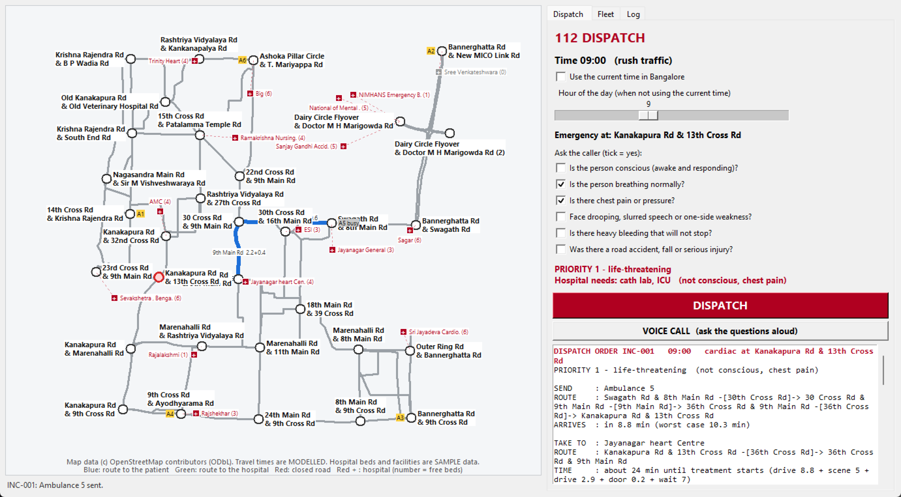

# Ambulance Dispatch - Jayanagar, Bangalore

A desktop control-room tool for a **112 emergency call**. The operator clicks where the emergency is on a **real map of Jayanagar, Bangalore** (OpenStreetMap), ticks the answers the caller gives to six **triage questions**, and the program chooses

- **which ambulance** to send,
- **which route** it takes (found with the [Dijkstar](https://pypi.org/project/Dijkstar/) routing library), and
- **which hospital** the patient is taken to,

and **explains every decision** on screen.



> **This is a prototype, not a medical or emergency-service tool.** The triage rules are a simplified example, travel times are modelled, and hospital beds and facilities are sample data (see [What is real](#what-is-real-and-what-is-not)).

## Quick start

You need Python 3 with `tkinter` (included with the standard Python installer for Windows and macOS).

```bash
pip install -r requirements.txt
python app.py
```

The voice call needs Windows (it uses the speech engine built into Windows). Everything else works on any system.

## How to use it

1. **Click the emergency's junction** on the map. Hospitals are the red `+` markers (the number is the free beds); ambulances are the yellow tags.
2. **Tick the caller's answers** (a tick means "yes"). The priority and the facilities the hospital will need appear under the questions.
3. Press **DISPATCH**. The chosen route to the patient is drawn in blue, the route to the hospital in green, and the **Dispatch** tab explains the decision, including why other hospitals were rejected and what a plain "nearest" rule would have done.
4. Click a **road** to close it (it turns red and later routes avoid it), and click a grey **busy ambulance** when it is back in service.
5. **VOICE CALL** asks the six questions aloud and listens to "yes" or "no" (Windows). **Fleet** shows the ambulances and lets you adjust hospital beds. **Log** keeps every call and saves it as a CSV file.

Time: by default the program uses the **current time in Bangalore** to choose between night, day and rush-hour travel times. Untick the box to pick an hour yourself (for example to see the rush hour).

## How it works

### 1. Triage: six questions to a priority

| Question | Counts as |
|---|---|
| Is the person conscious? | a "no" is a danger sign |
| Is the person breathing normally? | a "no" is a danger sign |
| Is there chest pain or pressure? | danger sign |
| Face drooping, slurred speech or one-side weakness? | danger sign (stroke) |
| Is there heavy bleeding that will not stop? | danger sign |
| Was there a road accident, fall or serious injury? | injury |

| Result | Priority | Roads are priced by |
|---|---|---|
| Any danger sign | **1 - life-threatening** | worst case (usual time + possible delay) |
| No danger sign, but an injury | **2 - urgent** | usual time + half the possible delay |
| Neither | **3 - not urgent** | usual time |

The kind of care is chosen in this order: injury or heavy bleeding means **accident**; stroke signs mean **stroke**; chest pain, unconscious or not breathing means **cardiac**; otherwise **minor**. These rules are in `ambulance/triage.py` and are a simplified example, **not a real medical protocol**; a real control room would replace them with its own.

### 2. Routing: Dijkstra with the Dijkstar library

`ambulance/routing.py` uses **Dijkstar**, a small library that implements Dijkstra's shortest-path algorithm. Three details make it fit an ambulance map:

- **Multigraph.** Dijkstar keeps one edge between two junctions, but an edge can carry any data. Each edge carries the **list of roads** between its two junctions, and the cost function charges the cost of the **best** one. Where two roads join the same junctions (14 of the 57 links), the choice between them is part of the normal search.
- **Priority and traffic.** The cost of a road depends on the priority (table above) and on the traffic period (night, day or rush hour). A road is stored as `(usual minutes, extra minutes)` per period, so the quick-but-unpredictable road and the longer-but-steady road can be told apart.
- **Closed roads.** A closed road is left out of the graph (rebuilt only when a road is closed or opened).

The traffic period is fixed when the call is taken and used for the whole journey.

### 3. Hospital choice

A hospital is only considered if it has the **facilities the case needs** and a **free bed**:

| Care | Hospital must have |
|---|---|
| cardiac | cath lab, ICU |
| stroke | stroke unit, CT scan |
| accident | trauma unit (plus a blood bank at priority 1) |
| minor | general care |

Among the hospitals that qualify, the lowest **travel time + time from the junction to the door + waiting time** wins. Each dispatch uses up one free bed.

### 4. Explanation

Every dispatch lists each ambulance (usual and worst-case time) and each hospital (accepted with its times, or rejected with the reason, for example `rejected (no cath lab, no ICU)`), and compares the result with a plain "nearest ambulance, nearest hospital" rule.

## What is real and what is not

| | Source |
|---|---|
| Junctions, road shapes, road names, road lengths | **Real**, from OpenStreetMap |
| Hospital names and positions | **Real**, from OpenStreetMap (clinics, eye, dental and maternity hospitals are filtered out) |
| Traffic signals and speed bumps along each road | **Real**, from OpenStreetMap, and used in the travel times |
| Travel times (night, day, rush hour, possible delay) | **Modelled**: from road class, length and the real signals, with assumed speeds and delays. OpenStreetMap has no traffic data |
| Hospital beds, waiting times, facilities | **Sample data**. Facilities are guessed from the hospital's name (a trauma hospital gets a trauma unit); beds and waits are made up |
| Ambulance stations | **Sample data** |

The map files are in `data/`:

- `data/jayanagar.json` - the map built from OpenStreetMap (32 junctions, 71 roads, 16 hospitals).
- `data/survey.json` - the **hospital survey and ambulance stations**. Replace the sample beds, waiting times, facilities and stations with real values and the program uses them (the Fleet tab then stops showing the "SAMPLE" warning once `"sample"` is set to `false`).

The format (the hospital name and numbers below are placeholders; use the exact hospital names that are in `data/survey.json`):

```json
{
  "sample": false,
  "hospitals": {
    "<hospital name exactly as in survey.json>": {
      "beds_free": 4, "wait": 15, "facilities": ["general", "icu"]
    }
  },
  "ambulances": [ {"name": "Ambulance 1", "base": "<a junction name from jayanagar.json>"} ]
}
```

**Hospital names are real, their capabilities here are not.** The names and positions come from OpenStreetMap, but the beds and facilities attached to them are invented sample values, so a statement such as "hospital X has no cath lab" in this program means only "the sample survey lists it without one". Do not treat it as a fact about the hospital. If you prefer not to show real names next to invented data, replace the names in `data/jayanagar.json` and `data/survey.json` with your own labels.

Facilities are `general`, `trauma_unit`, `cath_lab`, `stroke_unit`, `icu`, `blood_bank` and `ct_scan`. An ambulance `base` must be one of the junction names in `data/jayanagar.json`.

**Rebuilding the map** (needs the internet; the finished data files are already included):

```bash
python build_map.py
```

This downloads Jayanagar from OpenStreetMap, picks the busiest intersections as junctions, joins them with the shortest road paths, finds a second genuinely different road between junctions where one exists, and writes `data/jayanagar.json`. It never overwrites your `data/survey.json`.

Map data (c) [OpenStreetMap contributors](https://www.openstreetmap.org/copyright), available under the Open Database License (ODbL). `data/jayanagar.json` is derived from that data and is shared under the same licence.

## Example cases

All at 09:00 (rush hour), with the sample survey. Times are minutes: usual / worst case. "Nearest" is a plain rule: the closest ambulance and the closest hospital, ignoring facilities and beds. These cases are checked by `tests/test_demo_cases.py`.

| Case | This program | Plain "nearest" rule |
|---|---|---|
| **Heart attack** (unconscious, chest pain) at *Kanakapura Rd & 13th Cross Rd* | Ambulance 5, **8.8 / 10.3**, to Jayanagar heart Centre | Ambulance 1, **7.8 / 13.4**, to AMC Multispeciality Hospital, which the **sample survey lists without a cath lab and an ICU** |
| Same place, caller **not in danger** | Ambulance 1, **7.8 / 13.4** (the quick road is fine for a priority 3 case) | the same |
| **Stroke** at *Bannerghatta Rd & Swagath Rd* | to NIMHANS Emergency Block | to Sagar Hospitals, which the **sample survey lists without a stroke unit** |
| **Minor case**, nearest hospital full, at 14:00 at *Bannerghatta Rd & New MICO Link Rd* | to NIMHANS Emergency Block | to Sree Venkateshwara Speciality Hospital, which the **sample survey lists with no free bed** |
| **Injury** at *Marenahalli Rd & 11th Main Rd*, then close *Ayodhyarama Rd* | **6.1 / 8.4** over Ayodhyarama Rd, then **6.5 / 8.7** by 9th Cross Rd and 24th Main Rd | (the same, the roads differ only when closed) |

## How much difference does the priority make?

Priority 1 prices roads by their worst case, priority 3 by their usual time. Over all 496 pairs of junctions in rush hour:

- the two priorities choose **different roads in 114 pairs (23%)**;
- in **53** of those the reliable road has a clearly better worst case (on average 1.3 minutes, up to 4.3 minutes), and in none is it worse;
- choosing the reliable road costs 0.5 minutes of usual time on average (at most 3.0 minutes).

So the effect is real but modest, and it rests on **modelled** variability (the assumed delay of each real traffic signal). To be open about how that came about: with a time model based only on road class and length, priority made almost no difference (the reliable road was clearly better in only 6 pairs, by at most 0.1 minutes). The figures above appeared after the model was given a delay for every real traffic signal and speed bump on a road; the size of those delays is an assumption chosen by the authors, not a measurement. With real traffic data the numbers would change. These results are on synthetic travel times and are not measurements of real Bangalore traffic.

## Project layout

```
app.py                  start the program
build_map.py            rebuild the map data from OpenStreetMap
requirements.txt        Dijkstar
ambulance/
    mapdata.py          loads the map and the survey into a "world" dictionary
    routing.py          routes with Dijkstar (multigraph, priority pricing, closed roads)
    triage.py           the questions, priorities and facility needs
    dispatch.py         picks the ambulance, route and hospital, and explains why
    voice.py            spoken questions (Windows), voice_helper.ps1
    gui.py              the desktop window
data/                   jayanagar.json (map), survey.json (hospital survey, sample)
tests/                  121 automated tests
docs/screenshot.png
```

The code uses plain functions, lists and dictionaries; there are no classes.

Run the tests with:

```bash
python -m unittest discover
```

They check the triage rules for all 64 answer combinations, compare Dijkstar's routes with an independent calculation (on a small test map and on the real map, with and without closed roads), test the hospital rules and the call log, validate the shipped map data, replay the example cases above, test the voice code (including real speech recognition on Windows) and drive the window.

## Limitations

- **Hospital beds, waiting times, facilities and ambulance stations are sample data.** Hospital names and positions are real, but the capabilities shown for them are not, and must never be read as facts about those hospitals.
- Travel times are **modelled**, not live; one-way streets are ignored; the map has 32 junctions, so a hospital is attached to its nearest junction and a short "door" time is added.
- The triage questions and rules are a simplified example, not a clinical protocol.
- Calls are handled one at a time: a busy ambulance is skipped by later calls, but there is no queue in which an urgent call overtakes a waiting one. A dispatched ambulance is shown at its starting junction until you mark it back in service, where it reappears at the hospital.
- The traffic period is fixed at the time of the call.
- There is no live traffic feed. Road closures are entered by hand.
- The voice call needs Windows, uses an American-English recogniser, and understands only "yes" and "no".

## Credits

- Map data: (c) OpenStreetMap contributors (ODbL).
- Routing: the [Dijkstar](https://pypi.org/project/Dijkstar/) library.
